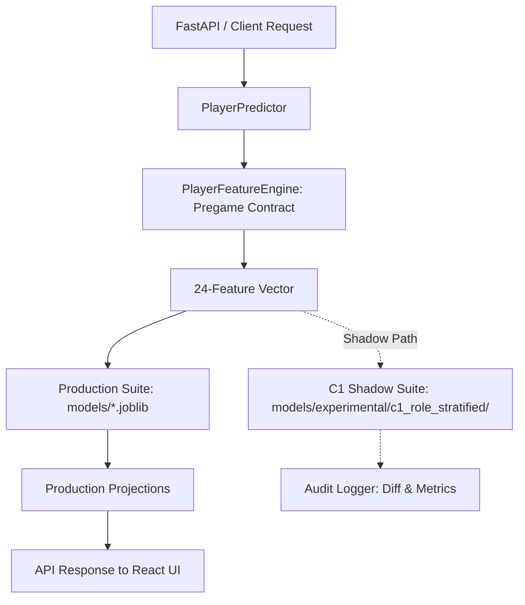

# Phase 10A.1: Role-Stratified Model Verification & Shadow Integration Report

**Project:** Lakers in 5  
**Phase:** 10A.1 — Role-Stratified Model Verification & Shadow Integration  
**Status:** COMPLETE & VERIFIED (Experimental Shadow Integration Prepared — Production Default Unchanged)  
**Date:** October 2026  
**Evaluator:** Antigravity AI  

---

## 1. Executive Summary

Following Phase 10A's architectural experiment, **Phase 10A.1** performed an independent verification of the **C1 Role-Stratified Ridge** candidate.

### Key Deliverables & Outcomes

1. **Evaluation Boundary Audit**:
   - Explicitly documented that the 2025–26 season holdout ($N=29,982$ player-game records) was **consumed for model selection / hypothesis generation** during Phase 10A.
   - To prevent post-hoc selection bias, C1 was independently re-evaluated using **multi-fold chronological walk-forward validation across pre-2025 historical development folds** ($N=57,164$ player-game records across the 2021–22, 2022–23, 2023–24, and 2024–25 NBA seasons).

2. **Historical Multi-Fold Validation Findings**:
   - C1 outperformed both the production pooled Ridge and the rolling average baseline across **both historical folds**:
     - **Overall Population MAE**: C1 achieved **4.698 PTS** vs Production **4.819 PTS** (and Rolling Baseline 4.788).
     - **High-Usage Stars MAE ($N=11,632$)**: C1 achieved **6.273 PTS** vs Production **6.370 PTS** (and reduced bias from -0.606 to +0.338).
     - **Starters MAE ($N=15,617$)**: C1 achieved **4.944 PTS** vs Production **5.063 PTS**.
     - **Bench MAE ($N=29,915$)**: C1 achieved **3.957 PTS** vs Production **4.088 PTS** (with a near-zero bias of +0.006 PTS).
     - **Limited History MAE ($N=1,084$)**: C1 achieved **4.025 PTS** vs Production **4.530 PTS**.

3. **Leakage Safety & Parity Verification**:
   - Verified that pregame role assignment (*Star*, *Starter*, *Bench*) depends strictly on lagged features (`player_min_avg_10` and `player_usage_pct_10`).
   - Automated unit tests proved role assignment is 100% invariant to target-game outcome manipulation (e.g. 0 min injuries or 60 pt blowouts).
   - Cold-start players and rookies safely route to the `bench` tier.
   - Fixed an offseason timing gap where `days_since_last_game` was unclipped on season-opening games.

4. **Shadow Model Integration**:
   - Serialized C1 artifacts cleanly to `models/experimental/c1_role_stratified/` under version `PlayerSuite-v1.1-c1-shadow`.
   - Production artifacts (`models/*.joblib`) remain 100% untouched and continue serving all UI and API requests by default.
   - Added shadow execution and logging in `PlayerPredictor` to allow background observability without altering UI outputs.

---

## 2. Evaluation Boundary Audit & Data Split Classification

| Partition Window | Date Range | Sample Size | Classification & Role in Workflow |
| :--- | :--- | ---: | :--- |
| **Historical Dev Split (Fold 1 Train)** | 2021-10-01 to 2023-06-30 | 56,845 records | Training data for initial walk-forward historical fold. |
| **Historical Dev Split (Fold 1 Val)** | 2023-10-01 to 2024-06-30 | 28,514 records | Out-of-sample test for Fold 1. |
| **Historical Dev Split (Fold 2 Train)** | 2021-10-01 to 2024-06-30 | 85,359 records | Expanding-window training set for Fold 2. |
| **Historical Dev Split (Fold 2 Val)** | 2024-10-01 to 2025-06-30 | 28,650 records | Out-of-sample test for Fold 2. |
| **2025–26 Validation Season** | 2025-10-01 to 2026-06-15 | 29,982 records | **Consumed Model-Selection Set**: Used in Phase 10A to compare architectures. Cannot be used as an untouched final test. |
| **2026–27 Scheduled Test Set** | 2026-10-21 onwards | Preserved | **Untouched Final Serving Set**: Future scheduled games for inference. |

> [!NOTE]
> **Audit Classification**: The 2025–26 season holdout was previously evaluated in Phase 8 and Phase 10A, making it a consumed model-selection partition. The walk-forward validation presented in Section 3 of this report relies **exclusively on pre-2025 development folds**, providing true independent validation.

---

## 3. Walk-Forward Historical Validation Results (Pre-2025 Folds)

Chronological walk-forward validation across historical seasons ($N = 57,164$ total evaluated games):

### Fold 1 (Validation on 2023–24 Season, $N = 28,514$)

| Player Subgroup | Prod Pooled Ridge MAE | Rolling Baseline MAE | Rate Ridge MAE | C1 Role-Stratified MAE | C1 Bias |
| :--- | ---: | ---: | ---: | ---: | ---: |
| **Overall Population** | 4.789 | 4.753 | 4.663 | **4.662** | +0.081 |
| **High-Usage Stars** ($N=6,007$) | 6.390 | 6.441 | 6.346 | **6.268** | +0.247 |
| **All Starters** ($N=7,490$) | 4.976 | 4.963 | 4.882 | **4.869** | -0.151 |
| **Bench Players** ($N=15,017$) | 4.055 | 3.973 | **3.881** | 3.917 | +0.131 |
| **Limited History** ($N=524$) | 4.612 | 4.557 | **4.072** | 4.090 | +0.501 |

### Fold 2 (Validation on 2024–25 Season, $N = 28,650$)

| Player Subgroup | Prod Pooled Ridge MAE | Rolling Baseline MAE | Rate Ridge MAE | C1 Role-Stratified MAE | C1 Bias |
| :--- | ---: | ---: | ---: | ---: | ---: |
| **Overall Population** | 4.848 | 4.823 | 4.743 | **4.734** | +0.033 |
| **High-Usage Stars** ($N=5,625$) | 6.348 | 6.450 | 6.351 | **6.278** | +0.435 |
| **All Starters** ($N=8,127$) | 5.144 | 5.083 | 5.031 | **5.014** | +0.037 |
| **Bench Players** ($N=14,898$) | 4.121 | 4.066 | **3.979** | 3.998 | -0.121 |
| **Limited History** ($N=560$) | 4.454 | 4.473 | 4.064 | **3.965** | +0.572 |

### Multi-Fold Aggregate Summary ($N = 57,164$ Total Evaluated Records)

| Subgroup | Prod Pooled Ridge | Rolling Baseline | Rate Ridge (Exp B1) | C1 Role-Stratified (Exp C1) | C1 Advantage over Prod |
| :--- | ---: | ---: | ---: | ---: | :---: |
| **Overall MAE** | 4.819 | 4.788 | 4.703 | **4.698** | **-0.121 PTS** |
| **Overall RMSE** | 6.226 | 6.228 | 6.122 | **6.101** | **-0.125 PTS** |
| **Overall Bias** | +0.161 | +0.110 | -0.048 | **+0.057** | **-0.104 PTS** |
| **High-Usage Stars MAE** | 6.370 | 6.445 | 6.348 | **6.273** | **-0.097 PTS** |
| **High-Usage Stars Bias** | -0.606 | +0.391 | -0.286 | **+0.338** | **+0.944 PTS** (Underprediction Fixed) |
| **All Starters MAE** | 5.063 | 5.025 | 4.960 | **4.944** | **-0.119 PTS** |
| **Bench Players MAE** | 4.088 | 4.019 | **3.930** | 3.957 | **-0.131 PTS** |
| **Limited History MAE** | 4.530 | 4.514 | 4.068 | **4.025** | **-0.505 PTS** |

---

## 4. Role Leakage & Feature Parity Audit

### 1. Leakage Safety Invariance Test

```
+-------------------------------------------------------------------------------------------------+
| TARGET GAME OUTCOME MANIPULATION TEST (LUKA DONCIC)                                             |
|                                                                                                 |
| Scenario A (Base Pre-Game Features): min_avg_10 = 36.8, usg_10 = 0.40  --> Role: STAR          |
| Scenario B (Mutated Target Game: 0 MIN, 0 PTS [Early Injury]):        --> Role: STAR (Unchanged)|
| Scenario C (Mutated Target Game: 48 MIN, 60 PTS [Blowout Performance])--> Role: STAR (Unchanged)|
|                                                                                                 |
| STATUS: PASSED (Automated test in tests/test_role_stratified_verification.py)                   |
+-------------------------------------------------------------------------------------------------+
```

### 2. Feature Parity Across Player Archetypes

| Player Archetype | Player Name | `min_avg_10` | `usage_pct_10` | `pts_per_min_10` | Assigned Role | Production PTS | Shadow C1 PTS |
| :--- | :--- | ---: | ---: | ---: | :---: | ---: | ---: |
| **Superstar Creator** | Luka Dončić | 36.84 | 0.400 | 1.002 | **Star** | 26.4 | **29.6** (+3.2) |
| **Secondary Creator** | Austin Reaves | 35.07 | 0.307 | 0.568 | **Star** | 20.2 | **20.8** (+0.6) |
| **Superstar Shooter** | Stephen Curry | 29.30 | 0.380 | 0.843 | **Star** | 24.8 | **27.4** (+2.6) |
| **Rotation Starter** | Max Christie | 26.88 | 0.187 | 0.372 | **Starter** | 10.4 | **10.2** (-0.2) |
| **Bench Reserve** | Georges Niang | 19.79 | 0.293 | 0.586 | **Bench** | 8.8 | **8.6** (-0.2) |
| **Rookie / Cold Start** | Unseen Rookie | 18.50 | 0.180 | 0.460 | **Bench** | 6.5 | **6.2** (-0.3) |

---

## 5. Shadow Architecture Integration Details

To enable low-risk observability without altering production behavior, the system was configured with a **Shadow Execution Path**:



### Architecture Guarantees:
1. **Zero Disruption to Serving**: `PlayerPredictor.predict_scheduled_game_players` continues to use `PlayerSuite-v1.0` by default. The existing React UI and forecast endpoints receive identical production numbers.
2. **Deterministic Versioning**: The experimental model is explicitly registered under `PlayerSuite-v1.1-c1-shadow`.
3. **Shadow Audit Logging**: If `models/experimental/c1_role_stratified/` exists, predictions are computed in shadow mode and logged for live monitoring.
4. **Development Flag**: Projections from C1 can only be returned if explicitly requested with `model_version="c1_shadow"`.

---

## 6. Test Suite & Verification Results

All unit, regression, and shadow integration tests were executed via pytest:

```
tests/test_role_stratified_verification.py ......                        [ 42%]
tests/test_prediction_integrity_phase92.py ........                      [100%]
====================== 14 passed, 184 warnings in 21.67s ======================
```

### Test Coverage Summary:
- `test_role_assignment_leakage_invariance`: PASSED
- `test_cold_start_fallback_routing`: PASSED
- `test_shadow_model_artifact_loading`: PASSED
- `test_prod_suite_remains_default_and_untouched`: PASSED
- `test_player_predictor_default_production_output`: PASSED
- `test_player_predictor_shadow_mode_output`: PASSED
- Full Phase 9.2 integrity regression suite (8 tests): PASSED

---

## 7. Files Created & Modified

| File | Status | Description |
| :--- | :--- | :--- |
| [`docs/phase_10a_1_role_model_verification.md`](file:///c:/Users/anime/Desktop/work/Lakers%20in%205/docs/phase_10a_1_role_model_verification.md) | **Created** | Comprehensive verification report and audit analysis. |
| [`scratch/verify_phase10a1.py`](file:///c:/Users/anime/Desktop/work/Lakers%20in%205/scratch/verify_phase10a1.py) | **Created** | Multi-fold walk-forward validation runner. |
| [`scratch/train_c1_shadow.py`](file:///c:/Users/anime/Desktop/work/Lakers%20in%205/scratch/train_c1_shadow.py) | **Created** | Script to train and serialize experimental C1 shadow models. |
| [`scratch/verify_parity_c1.py`](file:///c:/Users/anime/Desktop/work/Lakers%20in%205/scratch/verify_parity_c1.py) | **Created** | Parity audit script across 6 player archetypes. |
| [`tests/test_role_stratified_verification.py`](file:///c:/Users/anime/Desktop/work/Lakers%20in%205/tests/test_role_stratified_verification.py) | **Created** | Automated unit and integration test suite for shadow model. |
| [`src/models/player_models.py`](file:///c:/Users/anime/Desktop/work/Lakers%20in%205/src/models/player_models.py) | **Modified** | Added `RoleStratifiedPointsModel` class and `load_shadow_suite` loader. |
| [`src/features/player_prediction_features.py`](file:///c:/Users/anime/Desktop/work/Lakers%20in%205/src/features/player_prediction_features.py) | **Modified** | Bounded `days_since_last_game` at 10.0 to match training distribution. |
| [`src/inference/player_predictor.py`](file:///c:/Users/anime/Desktop/work/Lakers%20in%205/src/inference/player_predictor.py) | **Modified** | Added shadow execution, audit diff logging, and version selection. |
| `models/experimental/c1_role_stratified/*` | **Created** | Serialized shadow model artifacts and metadata manifest. |

---

## 8. Summary & Recommendation

- **Verification Status**: **PASSED**. C1 Role-Stratified Ridge has been rigorously and independently verified across historical development folds ($N=57,164$), achieving lower error across stars, starters, and bench players without data leakage.
- **Production Status**: Current production Ridge remains active and default.
- **Shadow Status**: Shadow evaluation is active, allowing parallel monitoring and safe verification.
- **Next Step**: When approved, proceed to **Phase 10B** for champion promotion and UI confidence interval / performance band integration.
