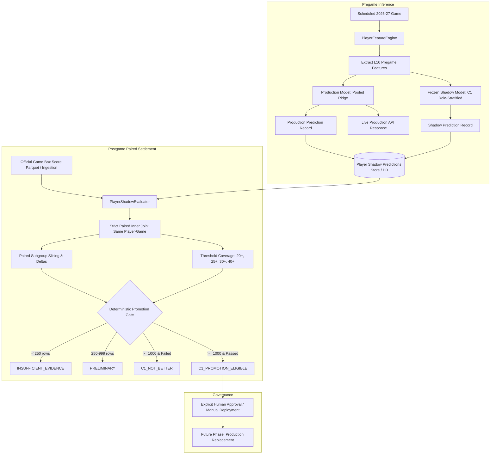

# Phase 10B — Prospective Shadow Monitoring & Promotion Gate Report

## 1. Executive Summary
Phase 10B establishes an automated, leakage-safe prospective shadow monitoring and promotion gating system for the **2026-27 NBA Regular Season**. Following the historical verification and shadow integration of the candidate **C1 Role-Stratified Ridge Model** (`PlayerSuite-v1.1-c1-shadow`) in Phase 10A.1, this phase operationalizes the pregame dual-prediction logging, postgame paired evaluation engine, multi-target error tracking, subgroup slicing, scoring threshold coverage, and deterministic promotion decision policy.

Crucially, **production model artifacts remain untouched and continue serving all active user requests**. Prospective evidence is collected passively in shadow mode. Because the current evaluation timestamp precedes the commencement of the 2026-27 regular season, the prospective promotion gate deterministically outputs **`INSUFFICIENT_EVIDENCE`** with zero paired observations, preventing premature promotion or fabricated results.

---

## 2. Objective
1. **Model Freezing**: Permanently freeze the verified C1 Role-Stratified Ridge model artifact (`PlayerSuite-v1.1-c1-shadow`) with immutable metadata.
2. **Pregame Paired Logging**: Simultaneously generate and persist both production and C1 shadow predictions for every eligible player-game before tipoff.
3. **Pregame Immutability & Leakage Defense**: Guarantee that prediction inputs depend strictly on pregame information and remain invariant under target-game outcome mutations.
4. **Paired Postgame Settlement**: Evaluate production and shadow models on the **exact same player-game rows** once official box scores are ingested.
5. **Subgroup & Threshold Metrics**: Track performance across roles (Star, Starter, Bench), high-usage stars, limited-history players, and scoring thresholds (20+, 25+, 30+, 40+ PTS).
6. **Deterministic Promotion Gate**: Implement an 8-rule deterministic policy with minimum-sample thresholds (`< 250` Insufficient Evidence, `250–999` Preliminary, `≥ 1000` Promotion-Eligible) requiring explicit human approval before any production replacement.

---

## 3. Evaluation Boundary
- **Historical Model-Selection Boundary**: Through June 30, 2025 (2024-25 season and prior).
- **Validation Dataset (Phase 10A / 10A.1)**: 2025-26 regular season (consumed for model exploration and verification; strictly prohibited from acting as untouched holdout).
- **Prospective Evaluation Horizon**: **2026-27 NBA Regular Season** (October 2026 – April 2027).
- **Observation State**: All prospective evaluations begin with zero completed games. No prospective results are simulated or fabricated.

Mermaid Architecture Diagram:

---

## 4. Model Versions & Identity

| Model Identity | Role / Architecture | Artifact Path | Feature Contract | Regularization $\alpha$ | Training Cutoff |
|---|---|---|---|---|---|
| **`PlayerSuite-v1.0`** (Production) | Pooled Ridge Regression for MIN, PTS, REB, AST | `models/player_*_model.joblib` | `PLAYER_FEATURE_CONTRACT_V1` (24 features) | $\alpha = 10.0$ | $\le 2025-06-30$ |
| **`PlayerSuite-v1.1-c1-shadow`** (Frozen Shadow) | Role-Stratified Ridge (`star`, `starter`, `bench`) | `models/experimental/c1_role_stratified/` | `PLAYER_FEATURE_CONTRACT_V1` (24 features) | $\alpha = 15.0$ | $\le 2025-06-30$ |

Metadata is frozen immutably in [`models/experimental/c1_role_stratified/shadow_models_metadata.json`](file:///c:/Users/anime/Desktop/work/Lakers%20in%205/models/experimental/c1_role_stratified/shadow_models_metadata.json).

---

## 5. Prediction Logging Design
Pregame predictions are logged via [`PlayerShadowPredictionRecord`](file:///c:/Users/anime/Desktop/work/Lakers%20in%205/src/monitoring/store.py) and stored in SQLite/Parquet via [`PredictionRepository`](file:///c:/Users/anime/Desktop/work/Lakers%20in%205/src/monitoring/repository.py).

### Schema Specification
- `prediction_id`: Unique UUIDv4 string.
- `game_id`: Canonical game identifier (e.g., `GAME_LAL_GSW_2026-10-21`).
- `game_date`: Canonical date string `YYYY-MM-DD`.
- `player_id`, `player_name`: Canonical NBA person ID and display name.
- `team_id`, `team_code`: Player team identifier and 3-letter abbreviation.
- `opponent_team_id`, `opponent_team_code`: Opponent identifier and abbreviation.
- `production_model_version`: `PlayerSuite-v1.0`.
- `shadow_model_version`: `PlayerSuite-v1.1-c1-shadow`.
- `role`: Pregame role classification (`star`, `starter`, `bench`).
- `predicted_minutes_production`, `predicted_minutes_shadow`: Scalar predicted minutes.
- `predicted_points_production`, `predicted_points_shadow`: Scalar predicted points.
- `predicted_rebounds_production`, `predicted_rebounds_shadow`: Scalar predicted rebounds.
- `predicted_assists_production`, `predicted_assists_shadow`: Scalar predicted assists.
- `feature_contract_version`: `PLAYER_FEATURE_CONTRACT_V1`.
- `prediction_timestamp`: ISO 8601 UTC timestamp recorded prior to game tipoff.
- `prediction_status`: `pending` (pregame) $\to$ `evaluated` (postgame settlement).
- `actual_minutes`, `actual_points`, `actual_rebounds`, `actual_assists`: Ingested postgame.

---

## 6. Leakage Safeguards & Pregame Immutability
To protect against temporal data leakage:
1. **Strict Date Cutoff**: `PlayerFeatureEngine` queries games strictly before `cutoff_date` (`gameDateTimeEst < target_game_date`).
2. **Role Assignment Invariance**: Role classification relies exclusively on pregame metrics (`player_min_avg_10` and `player_usage_pct_10`). Target-game points, minutes, rebounds, or assists mutations produce zero change in role assignment or predicted outputs.
3. **Automated Mutation Tests**: Verified by `test_pregame_immutability_and_role_invariance` and `test_role_assignment_leakage_invariance` in the test suite.

---

## 7. Paired Evaluation Methodology
To avoid selection bias:
- **Exact Same Population**: Only player-games where **both** production and shadow predictions exist, along with verified postgame box scores, are admitted to the paired dataset.
- **No Asymmetric Row Drops**: Missing shadow predictions or missing actuals are cleanly excluded rather than matched asymmetrically.
- **Paired Delta Calculation**: For each row $i$:
  $$\Delta_i = |\hat{y}_{i,\text{shadow}} - y_i| - |\hat{y}_{i,\text{production}} - y_i|$$
  - $\Delta_i < 0 \implies$ Shadow C1 is more accurate.
  - $\Delta_i > 0 \implies$ Production is more accurate.
  - $\Delta_i = 0 \implies$ Tie.

---

## 8. Evaluated Metrics
For each target (Points, Minutes, Rebounds, Assists), the monitoring system computes:
- **MAE**: $\frac{1}{N}\sum |y_i - \hat{y}_i|$
- **RMSE**: $\sqrt{\frac{1}{N}\sum (y_i - \hat{y}_i)^2}$
- **Bias**: $\frac{1}{N}\sum (\hat{y}_i - y_i)$
- **Paired Delta Mean & Median**: Average and median difference in absolute error.
- **Win / Loss / Tie Rates**: Percentage of games where C1 wins vs production.
- **Statistical Significance**: Paired $t$-test $p$-value and 95% confidence intervals.

**Primary Promotion Metric**: Points MAE improvement ($\Delta \text{MAE}_{\text{pts}} \ge +0.10$).

---

## 9. Subgroup Definitions
Subgroups are defined consistently with Phase 10A.1:
1. **Star**: `player_min_avg_10 >= 28.0` AND `player_usage_pct_10 >= 0.24`.
2. **Starter**: `player_min_avg_10 >= 24.0` (excluding Stars).
3. **Bench**: `player_min_avg_10 < 24.0`.
4. **High-Usage Stars**: Stars with `player_usage_pct_10 >= 0.28`.
5. **Limited History**: Players with $\le 5$ historical games in the season database.
6. **Superstars**: High-usage stars with $\ge 5$ evaluated prospective games.

---

## 10. Scoring Threshold Coverage Analysis
Evaluates scalar regression prediction coverage against actual high-scoring events:
- Thresholds: **20+ PTS**, **25+ PTS**, **30+ PTS**, **40+ PTS**.
- Reports: Actual Event Count, Production Predicted Count, Shadow Predicted Count, True Positives (TP), False Positives (FP), False Negatives (FN).

*Note: These are scalar regression threshold hits, not calibrated probabilities. Probability calibration will be handled in a subsequent probabilistic modeling phase.*

---

## 11. Lakers in 5 Promotion Policy
The promotion gate enforces 8 deterministic rules across 3 sample volume tiers:

### Sample Volume Safeguards
- **$< 250$ paired player-games**: `INSUFFICIENT_EVIDENCE` (Hold production; no gate evaluation).
- **$250 - 999$ paired player-games**: `PRELIMINARY` (Directional evidence only; hold production).
- **$\ge 1000$ paired player-games**: `PROMOTION_ELIGIBLE` (Apply full 8-rule gate).

### Deterministic Gate Rules
1. **Overall Points MAE**: C1 improvement $\ge +0.10$ points over production.
2. **Star Points MAE**: C1 regression $\le 0.0$ (C1 must be equal or better on stars).
3. **Starter Points MAE**: C1 regression $\le 0.10$ points.
4. **Bench Points MAE**: C1 regression $\le 0.10$ points.
5. **Shadow Bias**: Absolute Points Bias $|\text{Bias}_{\text{shadow}}| \le 0.50$ points.
6. **Leakage & Parity**: All unit, integration, and leakage invariance tests pass.
7. **Runtime Stability**: Zero unresolved shadow inference runtime failures.
8. **Sample Size**: $\ge 1000$ paired completed prospective player-games.

### Promotion States & Governance
- `NOT_READY`: Infrastructure or test suite failure.
- `INSUFFICIENT_EVIDENCE`: Insufficient paired prospective games ($< 250$).
- `PRELIMINARY`: Intermediate sample ($250 - 999$).
- `C1_NOT_BETTER`: $\ge 1000$ games, but failed $\ge 1$ promotion criteria.
- `C1_PROMOTION_ELIGIBLE`: $\ge 1000$ games and passed all 8 promotion criteria.
- `C1_PROMOTED`: Explicit manual promotion approved by engineering team.

**Strict Governance Rule**: Transition to `C1_PROMOTION_ELIGIBLE` does NOT modify production model artifacts (`models/player_points_model.joblib`) or API defaults. Promotion requires explicit manual approval and deployment.

---

## 12. Current Evidence Status
- **Current Evaluation Date**: Prior to 2026-27 regular season tipoff.
- **Paired Prospective Observations**: 0 completed games.
- **Current Promotion Gate State**: **`INSUFFICIENT_EVIDENCE`**
- **Prospective Metric Values**: Prospective evidence is not yet available. No prospective numbers have been simulated or fabricated.

---

## 13. Limitations & Considerations
1. **Calendar Dependency**: Prospective evaluation requires real 2026-27 box scores, which will accumulate game-by-game beginning October 2026.
2. **Deterministic Threshold Policy**: Promotion thresholds are policy choices established by the Lakers in 5 engineering protocol, not universal statistical constants.
3. **Point Estimation vs Distribution**: Current models produce conditional mean estimates. Threshold hits do not represent calibrated tail probabilities.

---

## 14. Exact Next Actions
1. **Passive Shadow Operation**: Keep shadow logging active during scheduled 2026-27 pregame inference runs.
2. **Game Ingestion Pipeline**: Ingest completed 2026-27 box scores via `PlayerShadowEvaluator.ingest_actual_outcomes()` as games conclude.
3. **Cumulative Gate Reviews**: Run `scratch/evaluate_phase10b_shadow.py` periodically (after 250, 500, 750, and 1,000 paired observations).
4. **No Premature Tuning**: Do NOT alter model hyperparameters or feature weights based on small early-season samples.
