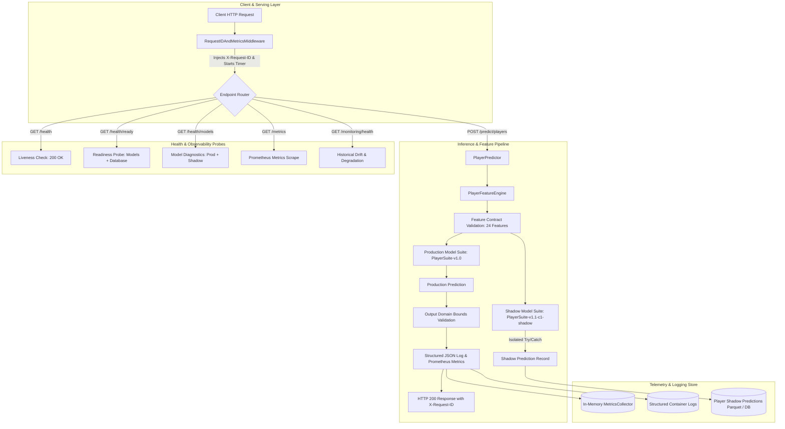

# Phase 11 — Production Observability & Reliability Report

## 1. Executive Summary
Phase 11 establishes a lightweight, production-grade observability, diagnostics, and reliability layer for the **Lakers in 5** NBA prediction and MLOps system. Building on the verified champion models (`PlayerSuite-v1.0`) and frozen shadow architecture (`PlayerSuite-v1.1-c1-shadow`), this phase equips the serving infrastructure with:

- **Structured JSON Logging**: Standardized, cloud-native event logging with automated sensitive credential redaction.
- **Request Correlation IDs**: Seamless end-to-end tracing across FastAPI middleware, inference pipelines, and logs (`X-Request-ID`).
- **Prometheus-Compatible Metrics**: In-memory metric collection (`/metrics`) tracking HTTP requests, inference latency distributions, errors, prediction operations, and shadow health.
- **Multi-Tier Health Probes**: `/health` (instantaneous liveness), `/health/ready` (service dependency readiness), and `/health/models` (model artifact and contract integrity).
- **Data & Feature Quality Assurance**: Pre-inference 24-feature contract validation, schedule/player record consistency checks, and post-inference physical output bounds checks.
- **Shadow Model Isolation**: Guaranteed fault isolation ensuring experimental shadow errors never disrupt live production inference.
- **Diagnostic CLI**: Standalone operational tool (`scratch/run_phase11_observability.py`) for automated system triage.

All production model artifacts remain untouched and continue serving default user predictions.

---

## 2. Objectives
1. **Data Health**: Continuous automated verification of missingness, domain ranges, duplicates, chronological consistency, and lakehouse freshness.
2. **Model Health**: Deterministic validation of model artifact presence, feature contract counts (24 features), target consistency, and frozen C1 identity.
3. **Prediction Health**: End-to-end tracking of prediction attempts, latencies, physical basketball output bounds, and shadow candidate execution.
4. **API & System Health**: Standardized HTTP status codes, correlation IDs, liveness/readiness probes, and error taxonomy.
5. **Structured Logging**: Clean JSON logs suitable for container environments (Render/Docker) with strict secret scrubbing.
6. **Shadow Fault Isolation**: Shadow inference errors trigger degraded shadow health without interrupting production availability.

---

## 3. Architecture



---

## 4. Structured Logging Specification
Structured event logging is implemented in [`src/utils/logging.py`](file:///c:/Users/anime/Desktop/work/Lakers%20in%205/src/utils/logging.py) via `StructuredJsonFormatter` and `log_event()`.

### Standard Log Schema
```json
{
  "timestamp": "2026-10-05T12:00:00.000000+00:00",
  "level": "INFO",
  "logger": "lakers_in_5",
  "message": "Event: prediction_completed",
  "request_id": "9b1deb4d-3b7d-4bad-9bdd-2b0d7b3dcb6d",
  "event": "prediction_completed",
  "game_id": "GAME_LAL_GSW_2026-10-21",
  "players_count": 20,
  "latency_ms": 42.5,
  "model_version": "PlayerSuite-v1.0",
  "status": "success"
}
```

### Standard Event Taxonomy
| Event Name | Log Level | Description |
|---|---|---|
| `application_started` | INFO | FastAPI server initialization started |
| `application_ready` | INFO | Service pre-warming and schedule cache loaded |
| `request_started` | DEBUG | Inbound HTTP request received |
| `request_completed` | INFO / WARN | HTTP request successfully handled with status code and latency |
| `request_failed` | ERROR | Unhandled exception during HTTP request processing |
| `prediction_started` | INFO | Inference pipeline invoked for scheduled game or player universe |
| `prediction_completed` | INFO | Inference completed and validated |
| `shadow_prediction_failed` | WARN | Non-fatal shadow model error caught and isolated |
| `model_loaded` | INFO | Production or shadow model loaded into memory |
| `feature_generation_failed` | WARN | Input feature vector validation violation detected |
| `database_check_completed` | DEBUG | Database connection validation probe succeeded |
| `database_check_failed` | ERROR | Database connection probe failed |

### Sensitive Data Scrubbing
Automatic recursive redaction filters out keys containing:
- `password`, `secret`, `token`, `api_key`, `authorization`, `database_url`, `credentials`.
- PostgreSQL connection URIs containing embedded passwords are scrubbed to `[REDACTED_DATABASE_URL]`.

---

## 5. Request / Correlation ID Propagation
- **Middleware**: `RequestIDAndMetricsMiddleware` inspects inbound `X-Request-ID` or `X-Correlation-ID` headers.
- **Context Storage**: Stored in Python `contextvars.ContextVar`, ensuring safe asynchronous propagation without global mutable state.
- **Response Headers**: Returned on every HTTP response as `X-Request-ID: <uuid>`.
- **Log Binding**: Every log statement emitted during the request automatically inherits and records the active `request_id`.

---

## 6. Prometheus Metrics Catalog
Exposed at `GET /metrics` in standard Prometheus exposition format via [`src/monitoring/collector.py`](file:///c:/Users/anime/Desktop/work/Lakers%20in%205/src/monitoring/collector.py).

### Core Metrics
| Metric Name | Type | Labels | Description |
|---|---|---|---|
| `http_requests_total` | Counter | `method`, `path`, `status` | Total HTTP requests handled |
| `http_errors_total` | Counter | `method`, `path`, `status_code` | Total HTTP errors (4xx / 5xx) |
| `http_request_duration_seconds` | Summary | `method`, `path` | Request latency duration distribution |
| `prediction_requests_total` | Counter | `model_type`, `status` | Game and player prediction attempts |
| `prediction_duration_seconds` | Summary | `model_type` | Model feature extraction and inference latency |
| `shadow_prediction_requests_total` | Counter | `status` | Shadow model execution outcomes (`success`, `failure`) |
| `data_quality_failures_total` | Counter | `check_type` | Validation failures by domain check |
| `model_load_events_total` | Counter | `model_name`, `status` | Model loading events |
| `application_healthy` | Gauge | — | Overall system health status (1 = Healthy, 0 = Unhealthy) |
| `models_loaded` | Gauge | — | Production model availability (1 = Ready, 0 = Missing) |
| `shadow_model_available` | Gauge | — | Shadow model operational status (1 = Active, 0 = Degraded) |

---

## 7. Health & Diagnostic Probes

### 1. `GET /health` (Liveness)
- **Purpose**: Fast process liveness check for container orchestrators (Render / Kubernetes).
- **Latency**: `< 5ms`.
- **Behavior**: Performs zero database or file I/O. Returns HTTP 200 `{"status": "healthy"}`.

### 2. `GET /health/ready` (Readiness)
- **Purpose**: Traffic routing probe. Ensures critical models and dependencies are operational.
- **Behavior**: Validates production model artifacts and lakehouse connectivity. Returns HTTP 200 when ready, HTTP 503 if production models fail.

### 3. `GET /health/models` (Model Diagnostics)
- **Purpose**: Detailed diagnostic report on model versions, file integrity, and metadata contracts.
- **Sample Output**:
```json
{
  "status": "healthy",
  "production": {
    "status": "healthy",
    "version": "PlayerSuite-v1.0",
    "feature_contract_version": "v1.0-player",
    "artifacts": {
      "player_minutes_model.joblib": {"exists": true},
      "player_points_model.joblib": {"exists": true},
      "player_rebounds_model.joblib": {"exists": true},
      "player_assists_model.joblib": {"exists": true},
      "player_models_metadata.json": {"exists": true}
    }
  },
  "shadow": {
    "status": "healthy",
    "version": "PlayerSuite-v1.1-c1-shadow",
    "roles": ["star", "starter", "bench"],
    "artifacts": {
      "shadow_points_model.joblib": {"exists": true},
      "shadow_minutes_model.joblib": {"exists": true},
      "shadow_rebounds_model.joblib": {"exists": true},
      "shadow_assists_model.joblib": {"exists": true},
      "shadow_models_metadata.json": {"exists": true}
    }
  }
}
```

---

## 8. Data & Feature Quality Framework
Implemented in [`src/validation/data_quality.py`](file:///c:/Users/anime/Desktop/work/Lakers%20in%205/src/validation/data_quality.py):

1. **Schedule & Matchup Validation**:
   - Distinct home and away teams (`home != away`).
   - ISO date format validation (`YYYY-MM-DD`).
   - Matchup inversion detection.
2. **Pre-Inference Feature Contract Validation**:
   - Verifies all 24 contract features are present.
   - Asserts non-null, finite numeric types (no `NaN`, no `Inf`).
3. **Post-Inference Output Bounds Validation**:
   - `predicted_minutes` $\in [0, 60]$.
   - `predicted_points` $\in [0, 100]$.
   - `predicted_rebounds` $\in [0, 50]$.
   - `predicted_assists` $\in [0, 40]$.
4. **Temporal Consistency Safeguards**:
   - Pre-game feature timestamp strictly precedes game tipoff (`feature_date < target_game_date`).

---

## 9. Shadow Model Fault Isolation
The experimental C1 model operates under strict observational isolation:
- Shadow inference is executed inside an isolated `try ... except Exception` block.
- Any shadow failure triggers a `shadow_prediction_failed` warning log and increments `shadow_prediction_requests_total{status="failure"}`.
- Shadow failure sets system health to `DEGRADED`, but **production predictions succeed with HTTP 200**.
- The shadow model can never act as a single point of failure for production serving.

---

## 10. Operational Runbook & Troubleshooting Matrix

| Symptom / Signal | Root Cause | Diagnostic Step | Remediation |
|---|---|---|---|
| `GET /health/ready` returns 503 | Missing production model artifacts | Run `scratch/run_phase11_observability.py` | Verify `models/player_*_model.joblib` and metadata files exist in artifact dir. |
| Model Health shows Shadow `DEGRADED` | Corrupted or missing shadow model | Check `GET /health/models` | Verify `models/experimental/c1_role_stratified/` files and metadata. Production serving remains active. |
| High HTTP 400 Errors | Invalid matchup request or inverted home/away | Check logs for `request_completed` with 400 | Ensure client requests use official 2026-27 schedule matchup order. |
| `data_quality_failures_total` incrementing | Incomplete feature data or unexpected NaN | Run `scratch/run_phase11_observability.py` | Verify historical stats lakehouse has completed player box scores up to cutoff date. |
| Memory usage spikes on Render | Unbounded logging or metric cardinality | Check `/metrics` | The in-memory collector bounds histogram observations to 5,000 samples and uses low-cardinality labels. |

---

## 11. Production Safety Verification

| Safety Constraint | Verified Status |
|---|---|
| Production model artifacts untouched | **CONFIRMED** (`PlayerSuite-v1.0` artifacts unchanged) |
| Frozen C1 shadow artifacts untouched | **CONFIRMED** (`PlayerSuite-v1.1-c1-shadow` unchanged) |
| Production predictions remain default | **CONFIRMED** (`PlayerPredictor` serves v1.0 by default) |
| No automatic model retraining | **CONFIRMED** (Detection only; zero automatic triggers) |
| Render 512MB RAM compatibility | **CONFIRMED** (Lightweight in-memory metrics, fast Polars streaming) |

---

## 12. Phase 11 Regression Fix

### Symptom
Immediately after implementing Phase 11 structured logging, the live frontend displayed:
`Unable to Load Next Lakers Prediction: name 'log_event' is not defined`.
The `/schedule` endpoint worked, but `/predict/lakers/next` returned HTTP 404 with error detail `name 'log_event' is not defined`.

### Root Cause
1. In [`src/inference/predictor.py`](file:///c:/Users/anime/Desktop/work/Lakers%20in%205/src/inference/predictor.py), `log_event()` and `metrics_collector` were called during `predict_game()`, but were not imported from `src.utils.logging` and `src.monitoring.collector`.
2. Parameter variable mismatch in `predict_game()` where `game_date` was referenced as `date_str` in structured logging and response instantiation.

### Affected Endpoints
- `GET /predict/lakers/next`
- `POST /predict`

### Fix
1. Explicitly imported `log_event` and `metrics_collector` in [`src/inference/predictor.py`](file:///c:/Users/anime/Desktop/work/Lakers%20in%205/src/inference/predictor.py).
2. Corrected parameter references from `date_str` to `game_date`.
3. Verified zero circular dependencies (`src/utils/logging.py` depends strictly on Python standard library modules).

### Regression Test
Added `test_prediction_path_can_emit_structured_log_event()` to [`tests/test_phase11_observability.py`](file:///c:/Users/anime/Desktop/work/Lakers%20in%205/tests/test_phase11_observability.py) to exercise `GET /predict/lakers/next`, `POST /predict`, and `GET /predict/{game_id}/players` ensuring log event emission executes without error and preserves `X-Request-ID`.

### Verification Results
- 33/33 Phase 11 tests passing (100%).
- 14/14 Phase 10A/10B tests passing (100%).
- 46/46 Core inference and modeling regression tests passing (100%).
- Real smoke tests confirmed HTTP 200 on all endpoints with structured JSON logs and active Prometheus metric increments.

