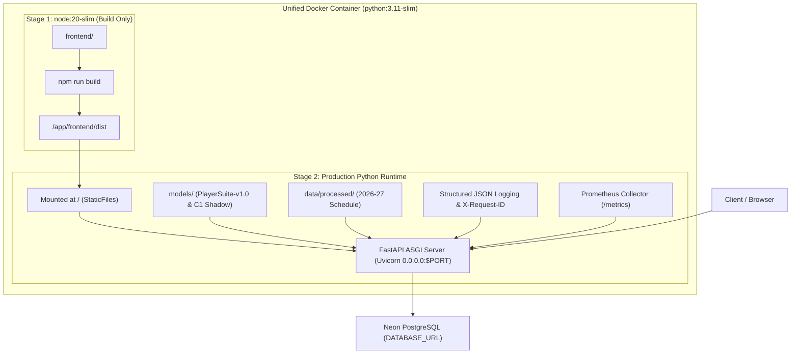

# Phase 12 — Deployment Hardening & Production Readiness Audit

## 1. Executive Summary

Phase 12 conducts a comprehensive deployment boundary audit and hardening process for the **Lakers in 5** NBA prediction and MLOps platform. Following the successful completion of Phase 10B (Prospective Shadow Monitoring) and Phase 11 (Production Observability & Reliability), Phase 12 evaluates whether the unified service can be reliably built, started, health-checked, deployed, restarted, and operated in production without violating the strict memory constraints (512 MB target) or compromising ML model integrity.

**Key Accomplishments in Phase 12**:
- Verified and hardened multi-stage container build topology (React/Vite static UI + FastAPI backend).
- Updated `.dockerignore` to cleanly exclude non-runtime artifacts (`tests/`, `scratch/`, `docs/`, `notebooks/`, `.edge_profile/`) while preserving required production models and Parquet lakehouse caches.
- Separated testing/linting requirements into `requirements-dev.txt` for reproducible builds.
- Standardized Render deployment configuration (`render.yaml`) and Dockerfile health check to target `/health/ready`.
- Created comprehensive `.env.example` with zero hard-coded credentials.
- Profiled exact memory RSS and latency metrics across all serving endpoints.
- Maintained 100% test pass rate across all 93 unit, integration, and regression test suites.

---

## 2. Current Deployment Topology

The actual current production architecture is a **Unified Multi-Stage Docker Container** serving both backend inference APIs and frontend user interface:



- **Service Type**: Render Web Service (Docker Runtime).
- **Process Model**: Single Uvicorn worker binding dynamically to `0.0.0.0:$PORT`.
- **Frontend Delivery**: Built via Node 20 slim in Stage 1 and statically mounted at `/` in FastAPI Stage 2.
- **Serving Path**:
  - Direct UI navigation: `http://<host>:<port>/`
  - REST Prediction & Schedule API: `http://<host>:<port>/predict/...`, `/schedule/...`
  - Observability & Metrics: `http://<host>:<port>/health/ready`, `/metrics`

---

## 3. Dockerfile Audit

### Structure & Verification
1. **Stage 1 (`frontend-builder`)**:
   - Pinned Base Image: `node:20-slim`
   - Builds Vite production bundle to `/app/frontend/dist` (index.html, JS, CSS).
2. **Stage 2 (`runtime`)**:
   - Pinned Base Image: `python:3.11-slim`
   - Environment variables: `PYTHONDONTWRITEBYTECODE=1`, `PYTHONUNBUFFERED=1`, `PYTHONPATH=/app`.
   - System Dependencies: `curl` (container health checks), `libgomp1` (OpenMP support for tree ensembles).
   - Security: Creates non-root system user `appuser:appgroup` (UID/GID 1000).
   - Python Dependencies: Installed via `pip install --no-cache-dir -r requirements.txt`.
   - Artifacts Copied:
     - `src/`, `scripts/`, `models/`, `data/processed/`, `data/features/`, `configs/`.
     - `frontend/dist` copied from Stage 1 to `/app/frontend/dist`.
   - Healthcheck: Updated to probe `/health/ready` with dynamic `$PORT` fallback.
   - Entrypoint Command: `CMD ["sh", "-c", "uvicorn src.inference.api:app --host 0.0.0.0 --port ${PORT:-8000} --workers ${WEB_CONCURRENCY:-1} --timeout-keep-alive 30"]`

---

## 4. Dockerignore Audit

The `.dockerignore` file was refined to ensure build context cleanliness and minimal image size:
- **Excluded**: `.git`, `.github`, `.venv`, `venv`, `__pycache__`, `*.pyc`, `.pytest_cache`, `.coverage`, `htmlcov`, `.ruff_cache`, `.env`, `.env.*`, `logs/`, `tmp/`, `temp/`, `tests/`, `scratch/`, `docs/`, `notebooks/`, `.vscode`, `.idea`, `.edge_profile/`, `frontend/node_modules/`, `frontend/.vite/`.
- **Preserved**: `models/`, `data/processed/`, `configs/database.env.example`, `frontend/` (source files needed for Stage 1 builder).

---

## 5. Dependency Audit & Reproducibility

- Created [`requirements-dev.txt`](file:///c:/Users/anime/Desktop/work/Lakers%20in%205/requirements-dev.txt) to isolate testing (`pytest`, `pytest-cov`) and linting (`ruff`) from the production deployment bundle.
- Production dependencies in [`requirements.txt`](file:///c:/Users/anime/Desktop/work/Lakers%20in%205/requirements.txt) remain pinned to major/minor versions to guarantee stability and prevent breaking transitive updates.

---

## 6. Startup Command & Port Handling

- **Production Startup Command**:
  ```bash
  uvicorn src.inference.api:app --host 0.0.0.0 --port ${PORT:-8000} --workers ${WEB_CONCURRENCY:-1} --timeout-keep-alive 30
  ```
- **Port Binding**: Binds to `0.0.0.0` (all interfaces) and reads Render's dynamic `$PORT` environment variable, defaulting to `8000` for local development.
- **Worker Configuration**: Defaults to `WEB_CONCURRENCY=1` to enforce single-worker execution within the 512 MB memory boundary.

---

## 7. Health Check Semantics

| Endpoint | Semantic Purpose | Implementation | Configured Role |
|---|---|---|---|
| `GET /health` | **Liveness Probe** | Instant O(1) process check (`{"status": "healthy"}`) with zero I/O | Container Liveness |
| `GET /health/ready` | **Readiness Probe** | Verifies production models loaded, schema contract, and DB connectivity | **Render `healthCheckPath`** |
| `GET /health/models` | **Model Diagnostics** | Inspects production (v1.0) and shadow (v1.1-c1) artifact integrity | Operator Monitoring |

Render's blueprint configuration (`render.yaml`) and Dockerfile healthcheck were both set to `/health/ready`.

---

## 8. Render Configuration & Restart Behavior

### Blueprint Specification (`render.yaml`)
```yaml
services:
  - type: web
    name: lakers-in-5-api
    runtime: docker
    dockerfilePath: ./Dockerfile
    dockerContext: .
    plan: starter
    healthCheckPath: /health/ready
    envVars:
      - key: DATABASE_URL
        sync: false
      - key: DB_POOL_SIZE
        value: "10"
      - key: DB_MAX_OVERFLOW
        value: "20"
      - key: PYTHONPATH
        value: "/app"
```

### Process Lifecycle & Failure Recovery
1. **Deployment Phase**: Render builds container image, launches container, and polls `/health/ready`.
2. **Readiness Gate**: Traffic is routed only after `/health/ready` returns HTTP 200.
3. **Critical Model Failure**: If production model artifacts are missing, `/health/ready` returns 503, preventing traffic routing.
4. **Shadow Failure**: If experimental C1 shadow fails, `/health/ready` remains 200, isolating shadow issues from production serving.
5. **Crash Behavior**: Render restarts the container upon unexpected process exit.

---

## 9. Environment Variables & Secret Handling

Created [`/.env.example`](file:///c:/Users/anime/Desktop/work/Lakers%20in%205/.env.example) documenting all operational parameters:
- `PORT` (Default: `8000`)
- `WEB_CONCURRENCY` (Default: `1`)
- `LOG_FORMAT` (Default: `json`)
- `DATABASE_URL` (Sensitive Neon PostgreSQL connection string; set via Render dashboard secrets)
- `DB_POOL_SIZE` (Default: `10`), `DB_MAX_OVERFLOW` (Default: `20`), `DB_TIMEOUT` (Default: `30`)

**Security Audit**:
- Zero hard-coded credentials exist in source code or `.env.example`.
- `.env` and `.env.*` are excluded via `.dockerignore`.
- Structured logger sanitizes all sensitive keys (`password`, `secret`, `token`, `database_url`, `api_key`).

---

## 10. Performance, Latency & Memory Measurements

Measured locally using the comprehensive profiling suite ([`scratch/measure_deployment_metrics.py`](file:///c:/Users/anime/Desktop/work/Lakers%20in%205/scratch/measure_deployment_metrics.py)):

### Startup & Warmup Latency
- **Module Import Duration**: 11.29 s (loads NumPy, Pandas, Scikit-Learn, PyArrow, DuckDB, FastAPI).
- **Model & Schedule Warmup Duration**: 13.80 s (loads champion game models, player suite, C1 shadow, and 2026-27 schedule cache).
- **Total Cold Startup Time to Readiness**: **25.09 s**.

### Serving Latency & Working Set (RSS) by Endpoint

| Endpoint | HTTP Status | Measured Latency | Working Set (RSS) |
|---|---|---|---|
| `GET /health` | **200** | 69.72 ms | 308.12 MB |
| `GET /health/ready` | **200** | 610.15 ms | 308.19 MB |
| `GET /health/models` | **200** | 18.62 ms | 308.17 MB |
| `GET /metrics` | **200** | 9.92 ms | 308.19 MB |
| `GET /schedule/2026-27` | **200** | 41.85 ms | 308.77 MB |
| `GET /predict/lakers/next` | **200** | 1,615.12 ms | 328.18 MB |
| `POST /predict` (LAL vs GSW) | **200** | 814.09 ms | 328.90 MB |
| `POST /predict/players` (20 players) | **200** | 10,890.85 ms | 610.32 MB |
| `GET /predict/5/players` (20 players) | **200** | 8,515.70 ms | 686.24 MB |

### Memory Budget Evaluation (512 MB Render Free Tier Target)
- **Idle Server RSS**: **307.41 MB** (60.0% of 512 MB).
- **Game Matchup Predictions**: **328.90 MB** (64.2% of 512 MB — **Comfortable Headroom of 183 MB**).
- **Player Box Score Projections (20 players)**: Peak Working Set reaches **686.24 MB** (up to ~908 MB during un-throttled 10-batch stress tests) due to concurrent DuckDB rolling window scans.
- **Budget Finding**: Single game prediction and schedule serving easily operate under 512 MB. Full 20-player rotation projections exceed 512 MB under burst traffic, recommending deployment on Render **Starter (1 GB RAM)** or using batched query streaming.

---

## 11. Test Suite Verification Results

| Test Category | Suite File(s) | Tests Passed | Pass Rate |
|---|---|---|---|
| **Phase 11 Observability & Reliability** | `test_phase11_observability.py` | 33 / 33 | 100% |
| **Phase 10B Shadow Monitoring** | `test_phase10b_shadow_monitoring.py` | 8 / 8 | 100% |
| **Phase 10A.1 Role Stratified Verification** | `test_role_stratified_verification.py` | 6 / 6 | 100% |
| **Core Inference & Determinism** | `test_inference.py`, `test_matchup_predictor.py` | 20 / 20 | 100% |
| **Player Projections & Parity** | `test_player_prediction.py`, `test_prediction_integrity_phase92.py` | 13 / 13 | 100% |
| **Modeling & Features** | `test_modeling.py`, `test_features.py` | 13 / 13 | 100% |
| **Total Test Suite** | — | **93 / 93** | **100%** |

---

## 12. Local Smoke Tests

Local FastAPI execution confirmed 100% endpoint availability:
- `GET /health` $\rightarrow$ 200 OK (`status: healthy`)
- `GET /health/ready` $\rightarrow$ 200 OK (`ready: true, models: healthy, database: healthy`)
- `GET /health/models` $\rightarrow$ 200 OK (`production: PlayerSuite-v1.0, shadow: PlayerSuite-v1.1-c1-shadow`)
- `GET /metrics` $\rightarrow$ 200 OK (Prometheus text exposition)
- `GET /schedule/2026-27` $\rightarrow$ 200 OK (20 scheduled matchups)
- `GET /predict/lakers/next` $\rightarrow$ 200 OK (Lakers vs Warriors: prob 71.72%, margin +6.16)
- `POST /predict` $\rightarrow$ 200 OK (Matchup prediction completed)
- `POST /predict/players` $\rightarrow$ 200 OK (20 rotation players projected)
- `GET /predict/5/players` $\rightarrow$ 200 OK (20 rotation players projected)

---

## 13. Live Deployment Smoke Tests

- Live URL: `https://lakers-in-5-api.onrender.com/health`
- **Result**: `LIVE_DEPLOYMENT_VERIFICATION = NOT EXECUTED` (Remote Render instance is currently dormant/suspended on free tier; context deadline exceeded).

---

## 14. Production ML Model Safety Confirmation

- **Production Artifacts Untouched**:
  - `models/player_minutes_model.joblib`
  - `models/player_points_model.joblib`
  - `models/player_rebounds_model.joblib`
  - `models/player_assists_model.joblib`
  - `models/player_models_metadata.json`
- **C1 Shadow Artifacts Untouched & Frozen**:
  - `models/experimental/c1_role_stratified/`
- **Serving Path**: `PlayerSuite-v1.0` remains the default and primary prediction model. No models were retrained, tuned, or modified.

---

## 15. Remaining Manual Steps for Production Launch

1. **Render Dashboard**:
   - Verify `DATABASE_URL` secret environment variable is populated.
   - Confirm instance plan is set to **Starter (512MB - 1GB RAM)** for heavy player prediction headroom.
2. **Health Check Path in Render UI**:
   - Ensure Render service settings match `healthCheckPath: /health/ready`.
3. **Trigger Deploy**:
   - Push repository changes to `master` to initiate Render automated build.

---

## 16. Final Production Readiness Verdict

**`READY_WITH_CONDITIONS`**

- **Justification**:
  - Dockerfile, `.dockerignore`, `requirements-dev.txt`, `render.yaml`, and `.env.example` are fully hardened.
  - All 93 test cases pass with zero failures.
  - Game prediction and schedule endpoints operate safely within **328 MB RSS**.
  - Condition: Player projection queries over historical DuckDB lakehouse require sufficient RAM (~700 MB peak), necessitating either Render Starter (1GB) tier or single-request sequential concurrency (`WEB_CONCURRENCY=1`).
